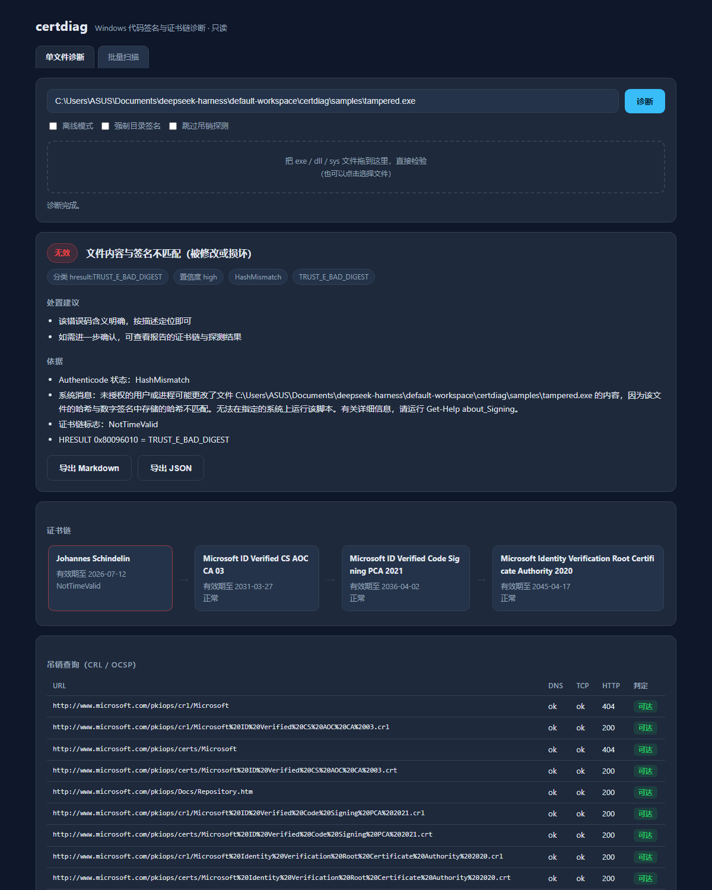
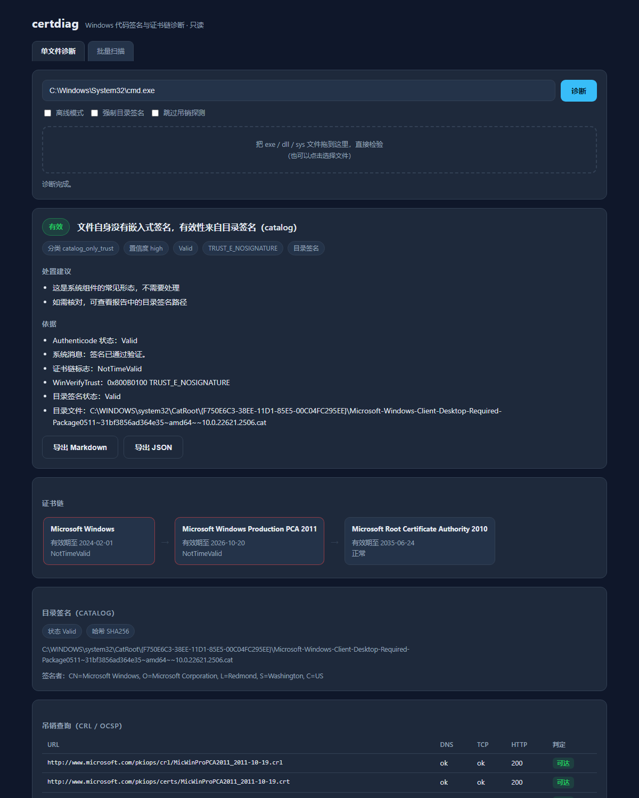
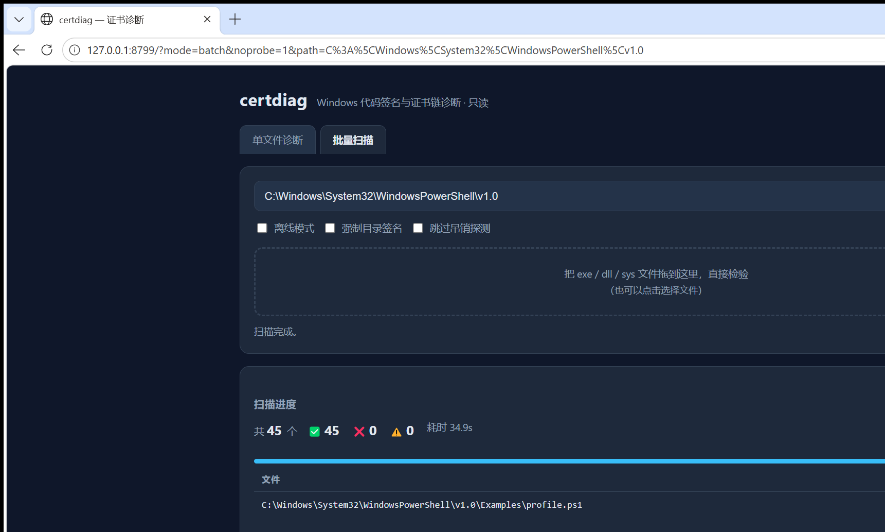
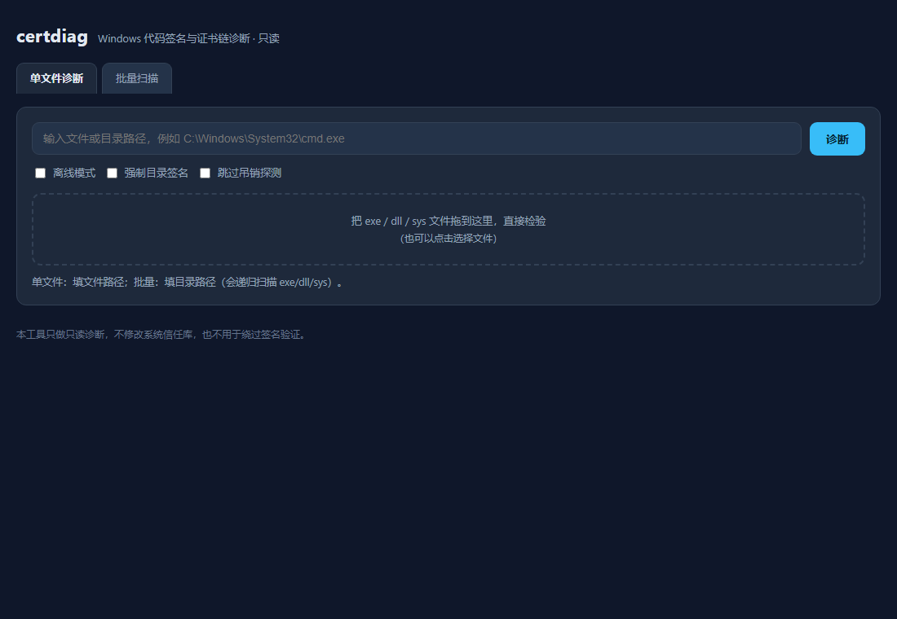

<p align="center">
  
</p>

<h1 align="center">certdiag</h1>

<p align="center">Windows 代码签名与证书链诊断工具 · 只读 · 零依赖</p>

<p align="center">
  <a href="https://github.com/ihadimh/certdiag/actions/workflows/test.yml"></a>
  
  
  <a href="LICENSE"></a>
</p>

> 把"这个 exe 为什么签名报错"从**猜**变成**有依据的判断**。

**一句话**：输入一个文件，输出「有效 / 无效 / 无法判定」+ 一句话根因 + 处置建议 + 完整证据链。

**走的是只读路线**：不装根证书、不改信任库、不绕过校验（详见 [SECURITY.md](SECURITY.md)）。

📌 [能做什么、不能做什么](docs/CAPABILITIES.md) · [维护与验证](docs/MAINTAINING.md) · [设计决策](docs/DECISIONS.md) · [已知问题](docs/KNOWN_ISSUES.md) · [真实路径审计](docs/REAL-PATH-REPORT.md) · [虚拟机验收](docs/vm-test-report.md)

📖 想看"为什么签名会误判"的完整故事：[Windows 提示"签名无效"，可能根本不是签名的问题](docs/article-signature-misdiagnosis.md)

```bash
git clone https://github.com/ihadimh/certdiag.git
cd certdiag

# 双击启动界面（Windows）
certdiag.bat

# 把文件拖到 certdiag.bat（或桌面快捷方式）上 = 直接检验该文件
# 把文件夹拖上去 = 批量扫描该目录

# 或命令行自检 + 启动
python verify.py
python -m certdiag --ui
```



## 这个工具解决什么问题

Windows 上签名校验失败时，系统给的往往是一句没用的话：

```
无法验证此文件的签名。签名无效或已损坏。
```

你无法判断到底是：

- 文件被改过？
- 根证书没装？
- 证书过期了？
- **还是只是连不上 CRL/OCSP，导致"吊销状态查不到"？**

最后一种最坑——证书本身完全正常，只是查询地址被墙/被代理拦了，但系统报出来的错误和"证书损坏"几乎一样。

`certdiag` 做的事：把签名状态、证书链、吊销地址连通性、目录签名覆盖情况一次性摊开，然后给出**一句话根因 + 处置建议 + 置信度**。

## 不是什么（重要）

- ❌ **不修改系统信任库**，不安装任何根证书
- ❌ **不绕过签名校验**，不做 patch/破解
- ✅ 只读诊断：读文件、读证书、发几个 HTTP 请求，然后输出报告

## 免安装便携版（推荐给不想装 Python 的人）

**[⬇ 下载 certdiag-portable-1.5.0.zip](https://github.com/ihadimh/certdiag/releases/download/v1.5.0/certdiag-portable-1.5.0.zip)**（约 11 MB，解压后**双击即用**，自带 Python 运行时）

```
certdiag-portable-1.5.0/
├── 双击启动.cmd      ← 打开图形界面（无黑框）
├── 命令行诊断.cmd    ← 把文件拖到它上面，直接出结论
├── runtime/          ← 自带 Python 3.12（embeddable）
├── certdiag/  docs/  samples/  tests/  tools/
└── verify.py  README.md  LICENSE
```

不需要安装、不需要管理员权限、不写注册表；删掉文件夹就是卸载。

> 用的是官方 [embeddable Python](https://www.python.org/downloads/windows/)，没有续期问题的第三方封装。
> 自己构建：`python tools/build_portable.py`

## 快速开始

```bash
# 诊断单个文件
python -m certdiag "C:\Program Files\XX\app.exe"

# 生成 Markdown 与 JSON 报告
python -m certdiag app.exe --md report.md --json report.json

# 离线模式：不发任何网络请求（只看链与有效期）
python -m certdiag app.exe --offline

# 批量扫描目录（只输出汇总）
python -m certdiag "C:\Program Files\XX" -q

# 强制检查目录签名（即使文件已有嵌入式签名）
python -m certdiag app.exe --catalog

# 图形界面（浏览器打开，推荐）
python -m certdiag --ui
```

环境要求：Windows + PowerShell（系统自带）+ Python 3.10+，**无第三方依赖**。

## 输出示例

系统组件（信任来自目录签名，文件本身没有嵌入签名）：

```
文件：C:\Windows\System32\cmd.exe
状态：Valid（Signature verified.）
结论：✅ 有效 — 文件自身没有嵌入式签名，有效性来自目录签名（catalog）
分类：catalog_only_trust  置信度：high
目录签名：Microsoft-Windows-Client-Desktop-Required-Package0511~...~10.0.22621.2506.cat（Valid）
```

商业软件（嵌入签名 + 吊销地址可达）：

```
文件：C:\Program Files\Cisco Packet Tracer 9.0.1\bin\PacketTracer.exe
状态：Valid（Signature verified.）
结论：✅ 有效 — 签名、证书链与吊销状态均已检查通过
分类：valid_revocation_checked_ok  置信度：high
```

Markdown 报告包含：结论、签名信息（含 WinVerifyTrust 的精确 HRESULT）、证书链逐跳表格、目录签名、每个吊销地址的 DNS/TCP/HTTP 探测结果。

## 设计要点：为什么"归因"才是核心

现成的工具（`signtool`、`certutil`、`Get-AuthenticodeSignature`）都能吐出状态码。难点在于**同一个状态码可能对应完全不同的原因**，而处置方式相反：

| 现象 | 常见误判 | 实际情况 | 处置 |
|---|---|---|---|
| `OfflineRevocation` + CRL 不可达 | 证书坏了 | 网络问题 | 换网络/配代理，别删证书 |
| `NotSigned` | 文件被篡改 | 可能是**目录签名** | 查 `.cat`，别急着重装系统 |
| 签名者证书过期 | 签名失效 | 有**时间戳**则仍有效 | 验时间戳，别重签 |
| `NotTrusted` | 根证书有病毒 | 缺中间证书或根未部署 | 装中间证书 |

所以 `attrib.py` 的规则是**按"具体→笼统"排序**的，且明确区分三类结论：

- `valid` — 通过
- `invalid` — 确定有问题（哈希不符、根不受信、已过期且无时间戳、被吊销、被显式不信任）
- `unknown` — **无法判定**（网络不通、离线、OCSP 不可测）

> `unknown ≠ invalid`。把"查不到"说成"有问题"，是这类工具最该避免的错误。

## 双数据源：PowerShell 状态 + WinVerifyTrust 错误码

两个 API 的视野不同，交叉使用才能精确定位：

| 数据源 | 能看到什么 | 盲区 |
|---|---|---|
| `Get-AuthenticodeSignature` | 嵌入签名 + **目录签名回退**，给粗粒度状态 | 不暴露具体 HRESULT |
| `WinVerifyTrust`（`WINTRUST_FILE_INFO`） | **精确 HRESULT**（吊销/过期/不信任/哈希不符） | **只看文件自身签名，不查目录** |

这解释了一个常见现象：`cmd.exe`、`notepad.exe` 这类系统组件，PowerShell 判有效，WinVerifyTrust 却返回 `0x800B0100 TRUST_E_NOSIGNATURE`——因为它们**没有嵌入式签名**，信任来自目录签名。

`certdiag` 据此新增了一个分类：

```python
# status == Valid + WinVerifyTrust 说 NOSIGNATURE + 找到 .cat
→ catalog_only_trust  "文件自身没有嵌入式签名，有效性来自目录签名"
```

同时严格限制 HRESULT 的"一票否决"范围——只有 `CERT_E_REVOKED`、`TRUST_E_EXPLICIT_DISTRUST`、`TRUST_E_BAD_DIGEST` 这三种码能单独定性，其余只作为证据记录，避免 NOSIGNATURE 误伤目录签名文件。

## 时间戳校验：从"有没有"到"令牌签名是否有效"

签名者证书过期时，结论取决于时间戳。很多工具只告诉你"有时间戳"，`certdiag` 会把令牌拆开验一遍——但**只验到令牌自身**，这离"可信时间戳"还有距离：

```
文件：git.exe（副本）
状态：Valid（签名已通过验证。）
结论：✅ 有效 — 签名者证书已过期；时间戳令牌的签名有效（TSA 信任链与用途未校验）
分类：expired_with_timestamp_signature_ok  置信度：medium
建议：这只能证明令牌本身没被篡改，不等于「可信时间戳」；
      时间戳由 Microsoft Public RSA Time Stamping Authority 签发（TSA 证书有效期至 2026-10-23）；
      需要完整结论时用 signtool verify /pa /t（会校验 TSA 链与用途）
```

做法（借 .NET 的 `SignedCms`，不手写 ASN.1）：

1. 从 PE 安全目录取出 PKCS#7 blob
2. `SignedCms.Decode` → `CheckSignature` 确认文件签名本身完好
3. 遍历未认证属性，找到时间戳令牌（`1.3.6.1.4.1.311.3.3.1`）
4. 把令牌当成独立的 `SignedCms` 再验一次（`CheckSignature(true)`，只验签名，不验签名者可信性）
5. 取 TSA 证书的主体与有效期

**没有做的**（所以置信度只给 medium）：

- 没有校验令牌里的 `messageImprint` 是否对应当前文件签名（RFC 3161 的绑定关系）
- 没有校验 TSA 证书是否带时间戳用途（EKU `1.3.6.1.5.5.7.3.8`）
- 没有校验 TSA 证书链在签发时刻是否有效

这三项需要完整的 CMS 解析与链校验，本工具暂不具备；需要完整结论时用 `signtool verify /pa /t`。

三种结论：

| 情况 | 分类 | 置信度 |
|---|---|---|
| 令牌验签通过 | `expired_with_timestamp_signature_ok` | medium（只证明令牌未被篡改） |
| 有令牌但验签失败 | `expired_with_broken_timestamp` | medium（结论 unknown） |
| 只有"有时间戳"的标记 | `expired_with_timestamp` | medium（推测） |

> 只在"签名者证书已过期"时才跑（约 250 ms），批量扫描不受影响；`--timestamp` 可强制开启。

## 性能

| 场景（`--no-probe`，本机实测） | 耗时 |
|---|---|
| 300 个系统 dll | **11.3 s**（38 ms/文件） |
| 600 个系统 dll | **25.8 s**（43 ms/文件） |
| 单文件（worker 已起） | ~20 ms |

> v2.0.0 把时间戳解析搬进常驻 worker，并把"整文件读入"改成"只读 PE 头 + 证书表"：
> 单个文件的令牌校验从 250~600 ms 降到 1~4 ms，300 个文件的批量从 77.6 s 降到 11.3 s。

> 测量条件：Windows 11 22621、`C:\Windows\System32\*.dll` 取 12 个、跳过网络探测、冷/热缓存未区分。
> **加速比只有约 1.2 倍**——早期文档里的"103 s → 4.5 s（23×）"是另一次不同条件下的数字，
> 不应再引用。worker 的真正收益主要在 PowerShell 启动慢的机器上（冷启动、杀软扫描、组策略），
> 单文件场景几乎没有差别。要复测请用同一批文件、同一 `--no-probe` 设置。

实现：一个常驻 PowerShell 进程，按行收发 JSON（`psworker.py`）。

```
发送：{"path": "C:\\x\\y.dll"}
接收：{"status": "Valid", "signer": {...}, "chain": {...}}
```

> 注意：不能用 `powershell -Command -`（它会把 stdin 整体当脚本读入），必须把脚本写成临时 `.ps1` 再用 `-File` 启动。
> worker 崩溃会自动重连一次，仍失败则回退到一次性 subprocess。

## 图形界面

```bash
python -m certdiag --ui            # 自动打开浏览器
python -m certdiag --ui --port 9000 --no-browser
```

界面是本地 Web（只监听 `127.0.0.1`，不对外开放），有两个页签。

### 单文件诊断



结论徽章、元信息 chips、处置建议、判定依据、证书链可视化、目录签名、吊销探测表、原始 JSON，一屏看全。

### 无效应答（篡改样本）


翻转一个字节后：`HashMismatch` + `TRUST_E_BAD_DIGEST` → **❌ 无效**，链上过期节点标红。

### 批量扫描



选目录后递归扫描 exe/dll/sys，结果以 **NDJSON 流**逐条返回，表格边扫边出；顶部有进度条和 有效/无效/无法判定 统计。

### 拖放检验



三种拖法，都通：

| 拖到哪 | 结果 |
|---|---|
| 网页里的虚线框 | 上传后在页面里显示完整报告 |
| `certdiag.bat`（或桌面快捷方式） | 弹出控制台，打印结论后暂停 |
| 把**文件夹**拖到 `.bat` 上 | 递归批量扫描该目录 |

实现说明：网页拖放走 `/api/upload`，文件先落到临时目录再诊断。Authenticode 与目录签名都基于内容哈希，复制不影响结论。

### 其他

- **导出**：单文件导 Markdown / JSON，批量导 JSON
- **URL 直达**：`/?path=<文件>`、`/?mode=batch&path=<目录>`

## 样本文件

`samples/make_test_samples.py` 生成两个测试样本：

| 文件 | 做法 | 预期结果 |
|---|---|---|
| `signed_ok.exe` | 复制一个带嵌入式签名的程序 | `valid` / `expired_with_timestamp` |
| `tampered.exe` | 同文件，翻转 `.text` 段一个字节 | **`invalid`** + `TRUST_E_BAD_DIGEST` |

```bash
python samples/make_test_samples.py
python -m certdiag samples/tampered.exe --no-probe
# 结论：❌ 无效 — 文件内容与签名不匹配（被修改或损坏）
```

> 脚本只复制并修改副本，不触碰任何系统文件。


## 支持的文件范围

Windows 的代码签名只覆盖特定类型，不是所有文件都能查：

| 类型 | 支持 | 说明 |
|---|---|---|
| `.exe` `.dll` `.sys` `.efi` `.ocx` `.cpl` | ✅ | PE 程序，嵌入式签名；也常被目录签名覆盖 |
| `.ps1` `.psm1` `.psd1` | ✅ | PowerShell 脚本，本身可带 `# SIG #` 签名块 |
| `.msi` | ✅ | 安装包，通常通过目录签名 |
| `.cab` | ⚠️ | 只有被目录签名覆盖时才有结论，否则 `NotSigned` |
| 文本 / 图片 / 压缩包 / 普通文件 | ❌ | `not_applicable`——这类文件本来就没有签名概念 |

> 判据：**文件类型本身没有签名**（`not_applicable`）≠ **有签名但无效**（`invalid`）。

## 启动方式（三种）

| 方式 | 行为 | 适合 |
|---|---|---|
| 双击桌面快捷方式 | 用 `pythonw.exe` 启动，**无控制台窗口**，自动开浏览器 | 日常使用 |
| 双击 `certdiag.bat` | 保留控制台（能看到日志） | 排错 |
| 把文件拖到 `.bat` 上 | 控制台直接打印结论 | 快速检验 |
## 代理支持

企业网络普遍走代理。`probe.py` 会先读代理设置再发请求，避免把"没走代理"误判成"地址不可达"：

| 来源 | 读取方式 |
|---|---|
| 环境变量 | `HTTPS_PROXY` / `HTTP_PROXY` / `ALL_PROXY` |
| Windows 系统代理 | 注册表 `Internet Settings` 的 `ProxyEnable` / `ProxyServer`（含 PAC 提示） |

检测结果会写进报告（`proxy` 字段），界面上也会显示"使用系统代理 / 直连"。

> 支持范围说明：目前只处理**显式 HTTP/HTTPS 代理**（环境变量或 Windows Internet Settings 里的
> ProxyServer）。`ProxyOverride` 绕过列表、PAC 脚本求值、SOCKS 代理都不完整支持。

探测有两条路径：

1. **直连**：DNS → TCP → TLS → HTTP
2. **代理兜底**：直连的 DNS 或 TCP 失败时，如果检测到代理，会经代理再发一次请求。成功则记为
   `ok`，detail 写「直连失败，经代理可达」

这一条是必要的：企业网络里经常是"本地 DNS 解析不了、但代理能解析"，只测直连会把可达的地址误判成不可达。

DNS 解析用工作线程 + `join(timeout)` 做软超时，**不改 `socket.setdefaulttimeout`**——那是进程级设置，会影响并发探测的其他线程，而且 `getaddrinfo` 并不保证遵守它。

## 目录结构

```
certdiag/
├── certdiag/
│   ├── collect.py    # 采集入口：worker 优先，subprocess 兜底
│   ├── psworker.py   # 常驻 PowerShell 进程（JSON 行协议）
│   ├── catalog.py    # 目录签名：反查 .cat 并验证其签名
│   ├── winverify.py  # WinVerifyTrust / HRESULT 映射
│   ├── timestamp.py  # 时间戳令牌校验（SignedCms）
│   ├── probe.py      # CRL/OCSP 探测（DNS/TCP/HTTP，走系统代理）
│   ├── proxy.py      # 代理设置读取（环境变量 / 注册表）
│   ├── attrib.py     # 归因引擎（核心）
│   ├── report.py     # JSON / Markdown / 终端
│   ├── ui.py         # 本地 Web 界面（http.server + 单页）
│   └── cli.py        # 命令行
├── tests/                # 52 个用例（含 Windows API 集成测试）
├── samples/          # 样本生成脚本（有效 / 篡改）
├── docs/             # 截图 + rules.json + 技术文章
├── verify.py         # 一键自检
├── certdiag.bat      # 双击启动界面
├── LICENSE
├── SECURITY.md       # 安全边界（只读、不写系统、不上传）           # MIT
└── README.md
```

## 运行测试

测试分两层：

| 文件 | 覆盖 |
|---|---|
| `tests/test_attrib.py` | 归因规则（纯函数，任何平台可跑） |
| `tests/test_cli.py` | 退出码语义、`--only` 筛选 |
| `tests/test_rules.py` | 规则表覆盖率（代码里的分类必须在 rules.json 里有说明） |
| `tests/test_windows_api.py` | **WinVerifyTrust / Catalog / 时间戳** 的真实调用（仅 Windows，CI 上跑） |

```bash
python -m unittest discover -s tests -v
# Ran 52 tests ... OK
```

测试固定的不变量：

1. **网络失败不能判成证书无效**
2. **OCSP 用 GET 探测失败不算不可达**
3. **WinVerifyTrust 的 NOSIGNATURE 不能覆盖目录签名的有效结论**
4. **只有强错误码才能一票否决**

## 已验证场景

| 场景 | 结果 |
|---|---|
| 正常签名的商业软件 | `valid`，链 3 跳，CRL 可达 |
| 证书过期且时间戳令牌验签通过 | `expired_with_timestamp_signature_ok`，置信度 medium |
| 证书过期但没有时间戳信息 | `expired_with_timestamp`，置信度 medium（推测） |
| 系统组件（仅目录签名） | `catalog_only_trust`，附 `.cat` 路径与签名状态 |
| OCSP 端点拒绝 GET | 标记 `inconclusive`，不影响总体结论 |
| CPS 声明页超时 | **忽略**，不计入吊销失败（曾误报，已修复） |

## 吊销检查：把"查没查"变成显式选择

以前工具在**三处**都把吊销检查关掉了（链构建 `NoCheck`、WinVerifyTrust `REVOKE_NONE`、只做网络探测），
却在结论里写"吊销检查通过"。这是把"没查"说成"查过了"。

现在它是一个显式开关：

| 档位 | 行为 | 耗时 |
|---|---|---|
| `off` | 不查。结论写"未检查"，绝不写"通过" | 0 |
| `cache`（默认） | 只用本地 CRL 缓存（`X509RevocationMode.Offline`） | +5%（约 15 ms/文件） |
| `auto` | 先探 CRL/OCSP 地址，可达才联网查，否则放弃并说明原因 | 0.3~15 s（批量约 +80%） |
| `online` | 强制联网查（`WTD_REVOKE_WHOLECHAIN`） | 2~30 s |

```bash
python -m certdiag app.exe                  # 默认 cache：命中就给结论
python -m certdiag app.exe --revoke=cache   # 毫秒级，缓存命中才有结论
python -m certdiag app.exe --revoke=auto    # 推荐：先探路再决定要不要查
```

同一个文件（Packet Tracer）三种档位的实际输出：

```
# off —— 2.7 秒，明确说没查
结论：✅ 有效 — 签名与证书链有效；未检查吊销状态（--revoke=off）
分类：valid_revocation_unchecked  置信度：medium
吊销：未检查（--revoke=off）

# cache —— 3.3 秒，本机缓存里没有 CRL 时应如实说"无法确认"
结论：⚠️ 无法判定 — 吊销状态未知（系统链报告 OfflineRevocation）
分类：revocation_unverified  置信度：medium
吊销：未检查（系统链报告 OfflineRevocation）

# auto —— 4.9 秒，探测到地址可达后真的联网查了
结论：✅ 有效 — 签名、证书链与吊销状态均已检查通过
分类：valid_revocation_checked_ok  置信度：high
吊销：已检查（正常）
```

> `cache` 档有个副作用：用 `auto` 查过一次之后，CRL 进了本地缓存，再跑 `cache` 就能命中并给出
> `checked_ok`。这不矛盾——缓存命中本来就是吊销检查的正常路径之一。

`auto` 是关键的一档——它把 `probe.py` 的角色从"推断吊销"降级为"决定值不值得查"：

```
先花 0.3 秒探地址
  ├─ 可达 → 打开 Online 去查（反正查得到）
  └─ 不可达 → 不查，明确写「未检查（ocsp.digicert.com 连接被重置）」
```

这样既不会在网络不通时白等 30 秒，也不会凭空得出"检查通过"。

`--offline` 与 `--revoke=auto|online` 互斥，会直接报错退出（退出码 3）。

`--no-probe` 与 `--revoke=auto` 同时出现会提示：auto 依赖探测结果判断可达性，
没有探测会退化为「不查」。想联网查就解除 `--no-probe`。

离线模式除了不跑探测，还会给证书链设置 `DisableCertificateDownloads = $true`——
否则链构建仍可能通过 AIA 去下载中间证书，"离线"就名不副实。

对应三种结论：

| 情况 | 分类 | 置信度 |
|---|---|---|
| 查了、通过 | `valid_revocation_checked_ok` | high |
| 没查（off，或 auto 退化） | `valid_revocation_unchecked` | medium |
| 查了、被吊销 | `revoked` | invalid |

## 安全边界：证书里的地址不可信

证书扩展里的 CRL/OCSP 地址**不是可信输入**。恶意文件可以把自己的证书写成
`http://10.0.0.1/` 或 `http://127.0.0.1:8765/`，工具若照单探测，就等于替它扫内网。

因此默认行为是：

- 解析出目标 IP 后判断，落在**内网 / 回环 / 链路本地 / 保留 / 组播**段的一律不探测
- 该地址记为 `skipped_private`，并在报告里写明原因
- 确有内网 PKI 需要探测时，加 `--allow-private` 显式放开

另外，`--require-signature` 用于门禁场景：把「无签名 / 无法验证签名 / 目录签名无法确认」
也算作失败（退出码 1）。默认的 `--fail-on invalid` 不会因为"没签名"而失败——这是两个不同的用途，
别混用。

## JSON 输出结构（v2.0.0 起固定）

```json
{
  "schema_version": 2,
  "tool": "certdiag",
  "tool_version": "1.6.0",
  "generated_at": "2026-11-19T07:30:00+08:00",
  "count": 2,
  "reports": [
    {
      "evidence": [
        {"source": "powershell", "name": "Authenticode 状态", "value": "Valid",
         "weight": "high", "note": "…"},
        {"source": "winverifytrust", "name": "WinVerifyTrust",
         "value": "0x80096011 TRUST_E_MALFORMED_SIGNATURE", "weight": "medium", "note": "…"}
      ],
      "conflicts": [
        {"a": "powershell: Valid", "b": "winverifytrust: 0x80096011",
         "reason": "系统状态说有效，WinVerifyTrust 却报错"}
      ],
      "not_checked": ["吊销状态（档位 off）", "时间戳绑定与 TSA 信任链"],
      "confidence_basis": "证据之间存在冲突，无法给出一致结论",
      "signals": {
        "authenticode_status": "Valid",
        "winverifytrust": "0x80096011",
        "pe": {"is_pe": true, "truncated": false, "trailing_after_signature": 0},
        "aia_downloads_disabled": false,
        "conflict": true
      },
      "...": "其余字段"
    }
  ]
}
```

单文件和多文件是同一层结构。以前 1 条输出对象、2 条输出数组，用 `--only` 过滤后类型会变，脚本会炸。

`signals` 把三个来源的原始结论摊开；`conflict` 为 true 表示「PowerShell 说有效、WinVerifyTrust 却报错」，这类输入下结论一定是 `unknown`，不会给 `valid`。

## 严格模式：只对能保证的事下结论

默认行为是"排障友好"的：查不到吊销只写「未检查」，结论仍是 `valid`。

如果这个结论会被拿去做决定（门禁、审批、发布），用 `--strict`：

```bash
python -m certdiag app.exe --strict --revoke=auto
```

严格模式下，任何**影响结论**的证据缺口（吊销未查、时间戳绑定未验、采集失败）
都会把结论降为 `unknown`，而不是给一个 `valid`。

| 配置 | `cmd.exe`（目录签名） |
|---|---|
| 默认（cache 命中） | `catalog_only_trust` / **valid** / high，吊销显示「已检查」 |
| `--revoke=off --strict` | 同分类，但 **unknown** / low，原因写明「证据不足：吊销状态（档位 off）」 |

强证据（哈希不匹配、显式不信任、已吊销）不受影响——那些是确定结论。

## 谁说了算：系统判定优先

如果 Windows 说「Valid」且 `WinVerifyTrust` 返回 `S_OK`，本工具**不会**用自己的链构建结果推翻它。
我们构建链时可能因为不下载 AIA 而拿到 `PartialChain`——那是我方证据不全，不是文件有问题。

这类情况会作为证据记录（`evidence` 里带上链标志），结论仍按系统为准，置信度相应下调。

## 结果该怎么读

`valid` 的意思是「**签名这一项**没有发现问题」，不是「文件安全」。完整的适用边界见 [docs/CAPABILITIES.md](docs/CAPABILITIES.md)。
工具报告的是 Windows API 的结论，无法检测 API 自身被绕过的情形
（见 [SECURITY.md](SECURITY.md) 的「不能证明什么」）。

## 退出码与流水线集成

工具可以被脚本和 CI 直接消费——**不需要解析输出文本，看退出码就行**。

| 退出码 | 含义 |
|---|---|
| `0` | 全部有效 |
| `1` | 存在无效（`invalid`） |
| `2` | 没有无效，但存在无法判定（仅在 `--fail-on unknown` 时） |
| `3` | 跑不起来：路径不存在 / 没有可处理文件 / 采集失败 |

默认 `--fail-on invalid`：**"查不到吊销状态"不会让流水线变红**，只有真正确认无效才失败。这是 `unknown ≠ invalid` 在工程上的体现。

```bash
# 软件分发前的闸门：有任何一个无效就失败
python -m certdiag "D:\release" --no-probe --fail-on invalid
if errorlevel 1 exit /b 1

# 更严格：无法判定也算失败（离线环境慎用）
python -m certdiag "D:\release" --fail-on unknown

# 批量巡检时只要问题清单
python -m certdiag "C:\Program Files\XX" --only invalid --json bad.json
```

`--only` 只影响**输出**，统计仍是全量：

```
共 86 个文件：有效 84  无效 2  无法判定 0
按 --only invalid 筛选后输出 2 个
  ❌ C:\...\a.dll  [hresult:TRUST_E_BAD_DIGEST]
  ❌ C:\...\b.dll  [hash_mismatch]
```

### 报 bug 时带上环境

```bash
python verify.py --report env.md
```

生成的报告包含 Python 版本、PowerShell 路径与版本、`Get-AuthenticodeSignature` / `Get-FileHash` 是否可用、代理状态、可选依赖情况，以及 37 个测试的结果——**CI 抓到的三个环境差异 bug，这份报告能一次性暴露**。

## 配套技能（给 agent 用）

如果想让 AI 助手在遇到"签名无效"时自动按正确流程排查，装这个技能：

```powershell
git clone https://github.com/ihadimh/windows-signature-triage.git "$env:USERPROFILE\.dsh\skills\windows-signature-triage"
```

技能里是**判断流程**（四问决策树 + 红线清单），不包含工具本身；没有 certdiag 也能用，只是会退回到 `Get-AuthenticodeSignature` 等系统命令。

## 归因规则是公开数据

`attrib.py` 里的判断被整理成 **[docs/rules.json](docs/rules.json)**（22 条规则 + 红线清单），可以直接被文档、其他工具或 agent 消费：

```json
{
  "tool": "certdiag", "version": 1,
  "verdicts": ["valid", "invalid", "unknown"],
  "rules": [
    {"id": "revocation_unreachable", "verdict": "unknown",
     "title": "吊销查询地址不可达",
     "when": "系统报 OfflineRevocation 且 CRL/OCSP 访问失败",
     "action": "网络问题：换网络/配代理；不要删除证书"}
  ],
  "red_lines": ["不建议关闭签名校验 / 关闭杀软 / 加入白名单", "..."]
}
```

配套的覆盖率测试保证**代码里出现的每个分类都必须在这张表里有说明**——新增分支却忘了写文档，CI 会红。

重新生成：`python tools/dump_rules.py`

## 工程记录：CI 抓到的三个环境差异 bug

在中文 Windows 上开发时一切正常。接上 GitHub Actions（`windows-latest`：**英文环境 + PowerShell 7**）后，一次跑出三个崩溃——全是"本机能跑、换台机器就废"的类型。

| # | 报错 | 根因 | 修法 |
|---|---|---|---|
| 1 | `UnicodeEncodeError: 'charmap' codec can't encode characters` | 英文 Windows 控制台是 cp1252，脚本在调用 `fix_console()` **之前**就 `print` 中文 | 所有入口（`verify.py`、`samples/make_test_samples.py`、`tools/*.py`）第一件事就是修编码 |
| 2 | `The term 'Get-FileHash' is not recognized` | 精简 PowerShell 环境可能没有该 cmdlet，而它写在主流程里，一失败整条采集就抛异常 | 两级降级：`Get-FileHash` → `[SHA256]::Create()` 流式计算 → `null`；sha256 只是附加信息，绝不允许影响结论 |
| 3 | `The 'Get-AuthenticodeSignature' command was found in the module 'Microsoft.PowerShell.Security', but the module could not be loaded` | 从 PowerShell 7 启动 `powershell.exe`(5.1)，子进程**继承了 PS7 的 `PSModulePath`**，5.1 找不到自己的模块 | 解析顺序改为 `pwsh → powershell.exe`，优先用自带完整模块的 PS7 |

这三条的共同点：**在我的机器上永远不会出现**（中文控制台、完整 5.1、从 cmd 启动）。

### 三条教训

- **一个附加字段的失败不该让整个诊断崩掉**。sha256 取不到就留空，状态、签名者、证书链照常返回——这也是 `unknown ≠ invalid` 的同一种克制。
- **模块路径会跨进程继承**。同一个 `powershell.exe`，从 cmd 启动正常，从 pwsh 启动就废。
- **中文环境掩盖编码问题**。`print("自检")` 在中文 Windows 上永远成功，只有 cp1252 才会炸。

### 怎么复现

```powershell
# 在中文 Windows 上模拟英文控制台
$env:PYTHONIOENCODING='cp1252'
python verify.py
```

## 已知限制

| 限制 | 影响 | 计划 |
|---|---|---|
| 目录签名只做"查找 + 验证 .cat 自身签名" | 未做 `WinVerifyTrust` 的完整目录校验 | v3 补 `WINTRUST_CATALOG_INFO` |
| 时间戳只验令牌签名与 TSA 证书信息 | 未做 TSA 完整信任链与吊销检查 | v3 补 `CertGetCertificateChain` |
| 不验证 OCSP 响应签名 | 只判断可达性 | v3 用 `cryptography` 做 ASN.1 校验 |
| 代理只读环境变量与 IE 设置 | 不解析 PAC 脚本，PAC 环境仍可能误判 | v3 支持 PAC |

## Roadmap

- [x] MVP：采集 + 链 + 吊销探测 + 归因 + 双格式报告
- [x] 目录签名（catalog）查找与验证
- [x] WinVerifyTrust 精确 HRESULT
- [x] 常驻 PowerShell worker（23 倍提速）
- [x] 读取系统代理配置
- [x] 本地 Web 图形界面
- [x] 时间戳令牌校验（SignedCms）
- [ ] C# 版本（单文件分发）

## 许可

MIT
