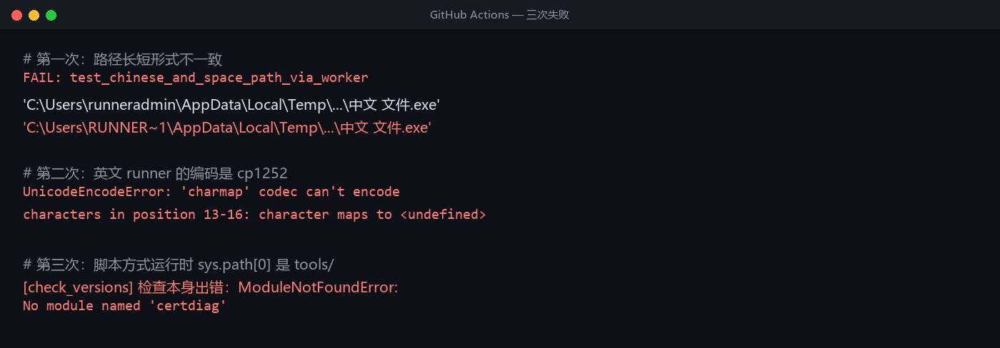
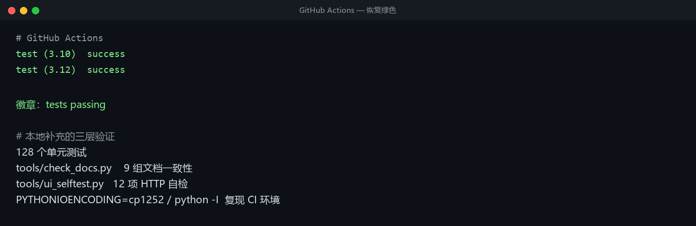

# 徽章红了三个月，因为没人打开日志

README 顶部那个 `tests` 徽章，从我加了一条"中文路径要能诊断"的回归测试那天起，就一直是红的。

不是偶尔红，是**每一次 push 都红**。而我每次看 CI 都只看一眼"失败了"，然后想"本地不是过得好好的"。

直到有人问："你这仓库怎么是 failing？"

我才去把日志下载下来。看完发现：**三个 bug 叠在一起，修掉一个才露出下一个。而且每一个，本地都复现不了。**

---

## 一、第一个：8.3 短名

CI 日志里第一次失败长这样：

```
FAIL: test_chinese_and_space_path_via_worker
AssertionError: 'C:\Users\runneradmin\AppData\Local\Temp\tmpnm1ple2h\中文 目录\中文 文件.exe'
             != 'C:\Users\RUNNER~1\AppData\Local\Temp\tmpnm1ple2h\中文 目录\中文 文件.exe'
```

同一个文件，两个路径写法。左边是长名，右边是 8.3 短名（`RUNNER~1`）。

我的测试是这么写的：

```python
r = w.collect(str(target), 30, "NoCheck", False)
self.assertEqual(r.get("path"), str(target))
```

`target` 来自 `tempfile.mkdtemp()`，Python 给的是短名；PowerShell 返回的是长名。**字符串当然不相等。**

这个测试要验证的是"中文路径能被正确处理"，结果它验证的是"两个路径字符串是否一模一样"。

修法：

```python
import os
self.assertEqual(os.path.normcase(os.path.realpath(r.get("path") or "")),
                 os.path.normcase(os.path.realpath(str(target))))
```

`realpath` 会把短名解析成真实路径，两边归一后再比。

**为什么本地没发现**：我这台机器的 `%TEMP%` 没有 8.3 短名，`tempfile` 和 PowerShell 返回的是同一个字符串。

---

## 二、第二个：cp1252

修完路径，我以为绿了。CI 还是红，这次挂在"文档一致性"这一步：

```
Traceback (most recent call last):
  File "tools/check_docs.py", line 246, in main
    print("  OK  " + c)
  File "C:\hostedtoolcache\windows\Python\3.12.10\x64\Lib\encodings\cp1252.py", line 19, in encode
UnicodeEncodeError: 'charmap' codec can't encode characters in position 13-16:
character maps to <undefined>
```

runner 是英文 Windows，`stdout` 编码是 **cp1252**。我那个检查器打印的是：

```python
print("  OK  " + "28 个分类与 rules.json 对齐")
```

中文塞不进 cp1252，直接抛异常，整个步骤失败。

**为什么本地没发现**：我的控制台是中文 Windows（GBK）或 UTF-8，中文能编码。CI 是英文镜像，编不了。

这个项目里其实早就有解决方案——`certdiag/cli.py` 里的 `fix_console()`：

```python
def fix_console() -> None:
    for stream in (sys.stdout, sys.stderr):
        try:
            stream.reconfigure(errors="replace")
        except Exception:
            pass
```

但 `tools/` 下的脚本是我后来陆续加的，一个都没调用它。

修法是给 14 个会打印中文的脚本统一加这段（只设 `errors="replace"`，保证不崩；显示效果交给 `chcp`）。

---

## 三、第三个：`sys.path`

修完编码，CI 又红，还是"文档一致性"，但错误变了：

```
- [check_versions] 检查本身出错：ModuleNotFoundError: No module named 'certdiag'
```

我在 `tools/check_docs.py` 里写了 `import certdiag` 取版本号，但**用脚本方式运行**时：

```
python tools/check_docs.py
```

`sys.path[0]` 是 `tools/` 目录，不是仓库根。所以 `import certdiag` 找不到。

**为什么本地没发现**：我的环境里 `PYTHONPATH` 恰好包含了仓库根，`import` 一直成功。

修法：

```python
ROOT = Path(__file__).resolve().parent.parent
if str(ROOT) not in sys.path:
    sys.path.insert(0, str(ROOT))
```

并且补了一条用 `-I`（隔离模式）跑的回归测试，本地就能复现"没有 PYTHONPATH"的环境：

```python
subprocess.run([sys.executable, "-I", "tools/check_docs.py"], ...)
```



*▲ 图 1：三轮失败的日志摘要——修掉一层才露出下一层*

---

## 四、三个 bug 的共同点

| 数量 | 层 | 本地为什么不炸 |
|---|---|---|
| 1 | 路径字符串的长短形式 | 我的临时目录没有 8.3 短名 |
| 2 | 控制台编码 cp1252 | 中文 Windows 不会编码失败 |
| 3 | `sys.path` | `PYTHONPATH` 帮我兜住了 |

三条都属于**"本地环境比 CI 环境宽松"**。

这解释了为什么"本地全绿"没有意义：**本地绿只证明代码在我这台机器上能跑，不证明它在别人的机器上能跑。**

---

## 五、修完之后

CI 现在是绿的：

```
test (3.10)  success
test (3.12)  success
```



*▲ 图 2：CI 恢复绿色，徽章变成 passing*

本地也补了几层验证：

- 128 个单元测试（含 6 个文档一致性用例）
- `tools/check_docs.py`：9 组文档与代码的对照检查
- `tools/ui_selftest.py`：12 项 HTTP 层自检（并发、413、403）
- 用 `PYTHONIOENCODING=cp1252` 模拟英文 runner
- 用 `-I` 模拟没有 `PYTHONPATH` 的环境

---

## 六、几条具体的教训

### 1. 徽章红了要看日志，不是看一眼颜色

我大概有十几次 push 之后看到 "failing" 就过去了。真正花时间的是下载日志——而下载日志只要 30 秒。

### 2. 测试里比较路径，永远不要比字符串

`C:\Users\RUNNER~1\...` 和 `C:\Users\runneradmin\...` 是同一个文件。
该用 `os.path.realpath`（或 `Path.resolve()`）归一，再比。

### 3. 打印中文的脚本，都要处理编码

不是"中文 Windows 才需要"——**英文 Windows 更需要**，因为那里根本编不了中文。
`PYTHONIOENCODING` 在 CI 里不可控，代码里设 `errors="replace"` 是保底。

### 4. 以脚本方式运行时，`sys.path[0]` 是脚本目录

`python tools/x.py` 和 `python -m tools.x` 的导入行为不一样。
工具脚本要显式把仓库根加进 `sys.path`，别指望环境变量。

### 5. 把 CI 环境搬到本地

三条修复里，有两条我现在能在本地复现：

```powershell
# 模拟英文 runner 的编码
$env:PYTHONIOENCODING='cp1252'
python -m unittest discover -s tests

# 模拟没有 PYTHONPATH 的干净环境
python -I tools/check_docs.py
```

**能本地复现的 bug，才有资格叫"修好了"。**

---

## 七、顺带做的一件事

修 CI 的过程中，我发现文档和代码之间也在悄悄漂移：

- README 的下载链接停在 v1.5.0（实际已经 2.1.x）
- 打包脚本里的"使用说明"写死 1.5.0，包内自带错误版本号
- `MAINTAINING.md` 停在 1.6.0，当时写着 97 个用例（真实数字是 128）
- README 性能章节：表格写 300 个文件 11.3 s，正文却说"12 个文件、加速 1.2 倍"

所以写了个 `tools/check_docs.py`，做 9 组检查：

| 检查 | 内容 |
|---|---|
| 分类名 | 代码里的 category 必须在 rules.json 有规则 |
| 命令行 | 文档提到的命令行参数必须真实存在 |
| 接口 | 文档提到的 `/api/*` 必须是真实路由 |
| 链接 | 文档内本地链接必须有效 |
| 版本 | 禁止写死便携包目录名、带版本下载链接、未来版本号 |
| 测试数 | 文档写的数量与实际（±5 容差） |
| 退出码 | 必须与 `EXIT_*` 常量一致 |
| JSON 协议 | `schema_version` 必须与代码一致 |
| 图片 | 文档引用的图片必须存在 |

它第一次运行就抓出了上面那 4 处过期内容。

---

## 八、最后

这次给我最大的提醒不是"要写测试"，而是：

> **失败信号一直在那儿，我看的是颜色，不是内容。**

CI 存在的意义不是我 push 完看到绿色勾，而是它能在**别人的环境**里跑一遍。如果我只在本地跑，这三个 bug 会一直待在那里——直到有用户在他的英文 Windows 上运行这个工具。

顺便说一句：这三个 bug 里，有两个会导致**真实用户看到错误的结论**（中文路径被报"文件不存在"），只有一个只是 CI 噪音。

**徽章红了三个月，实际坏掉的是功能，不只是颜色。**

---

项目地址：<https://github.com/ihadimh/certdiag>
