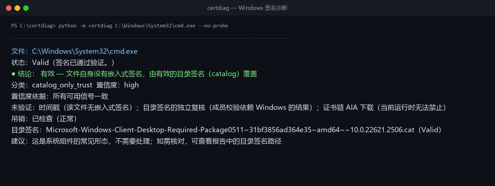
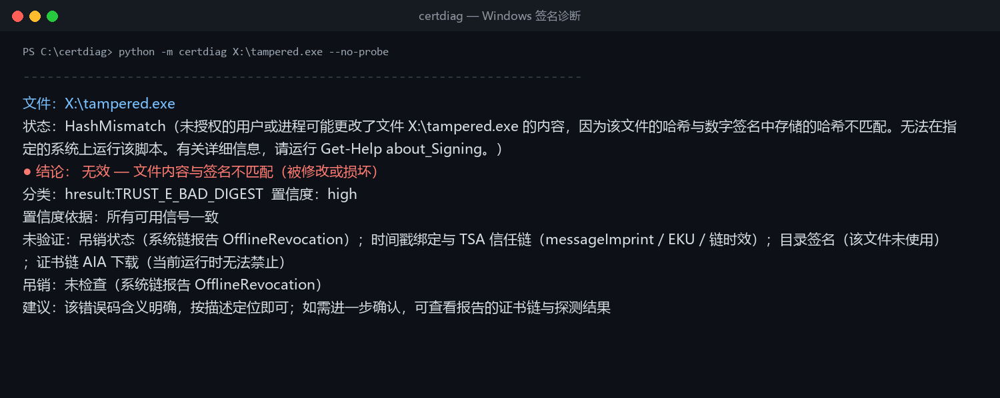
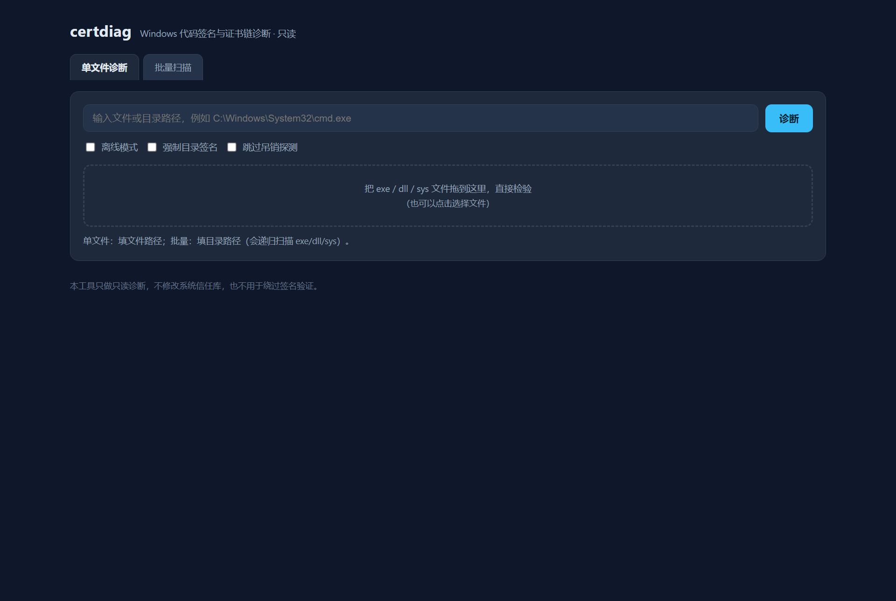
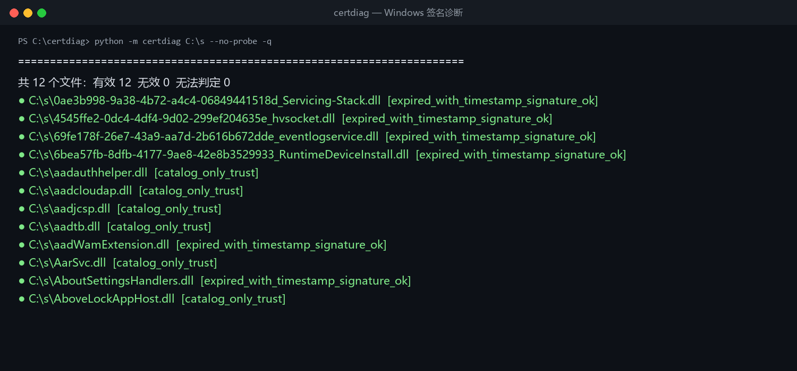

# 写了个 Windows 签名诊断工具：把"签名无效"拆成四类原因，还给出证据

Windows 上判断一个 exe 签名有没有问题，看起来是个已经解决的问题——`sigcheck`、`signtool`、PowerShell 的 `Get-AuthenticodeSignature`，随便挑一个都能给答案。

但实际排查时会发现，它们给的是**状态**，不是**原因**：

```
Get-AuthenticodeSignature app.exe

Status      : NotTrusted
StatusMessage : 签名验证失败
```

"失败"之后呢？是证书过期、根证书没装、文件被改过、还是只是这台机器查不到吊销列表？这三种情况的处理方式完全不同：

- 证书过期 → 看时间戳，可能仍然有效
- 根证书没装 → 企业内部 CA，装根证书
- 文件被改过 → 重新下载
- 查不到吊销 → 网络问题，不是文件问题

**把"查不到"当成"有问题"，是这块最常见的误判。**

我写了个工具来干这件事：**certdiag**，Python + PowerShell，只读，不装证书、不改注册表。仓库在 [github.com/ihadimh/certdiag](https://github.com/ihadimh/certdiag)。

---

## 一、它和 sigcheck 的区别

`sigcheck -a` 会给一大段签名信息，但不下结论；`signtool verify` 会报错码，但面向的是"签名者"，不是"排查者"。

certdiag 的输出是这样的：

```
文件：C:\Windows\System32\cmd.exe
状态：Valid
结论：✅ 有效 — 文件自身没有嵌入式签名，由有效的目录签名（catalog）覆盖
分类：catalog_only_trust  置信度：high
吊销：已检查（正常）
目录签名：Microsoft-Windows-Client-Desktop-Required-Package...cat（Valid）
建议：这是系统组件的常见形态，不需要处理
```



*▲ 图 1：cmd.exe 的实际输出——"没有嵌入式签名"不等于"没有签名"*

三件事是别的工具不做的：

1. **给分类**（`catalog_only_trust` / `expired_with_timestamp` / `hresult:TRUST_E_BAD_DIGEST` …）
2. **给证据**（每条结论列出它依据的信号，来源分 PowerShell / WinVerifyTrust / 目录签名 / PE 结构 / 时间戳 / 吊销）
3. **给置信度**（信号冲突时降级，采集失败时封顶）

---

## 二、四个真实例子

下面都是本机（Windows 11 22621）实测输出，不是编的。

### 1. `cmd.exe` 没有签名，但它是有效的

```
状态：Valid
结论：✅ 有效 — 文件自身没有嵌入式签名，由有效的目录签名（catalog）覆盖
分类：catalog_only_trust
```

Windows 系统组件大多没有嵌入式签名，靠 `C:\Windows\System32\CatRoot` 里的 `.cat` 文件按哈希覆盖。

**只看"有没有签名"，会把一半系统文件判成"未签名"。**

### 2. 证书过期了，签名仍然有效

```
状态：Valid
结论：✅ 有效 — 签名者证书已过期；时间戳令牌的签名有效（TSA 信任链与用途未校验）
分类：expired_with_timestamp_signature_ok  置信度：medium
```

签名者证书过期不代表签名失效——只要签名时打了时间戳，就能证明"签名发生在证书有效期内"。

工具会真的去解 PKCS#7、把时间戳令牌当独立签名验一遍，而不是只看到"有时间戳"就下结论。

### 3. 文件被改过

```
状态：HashMismatch
结论：❌ 无效 — 文件内容与签名不匹配（被修改或损坏）
分类：hresult:TRUST_E_BAD_DIGEST  置信度：high
```



*▲ 图 2：同一个命令跑篡改样本，分类直接落到 `hresult:TRUST_E_BAD_DIGEST`*

这条最确定，`0x80096010`。但也最容易被误归因——**很多人看到"签名无效"第一反应是证书问题，实际是文件不完整**。

### 4. 自签名程序

```
状态：Valid
结论：❌ 无效 — 签名者的根证书不在本机信任库中（自签名或内部 CA 的常见情况）
分类：untrusted_root  置信度：high
```

注意这里 `状态` 是 `Valid`——签名结构本身没问题，只是根证书不在这台机器上。**这两件事是分开的**，很多工具会混在一起说"签名无效"。

---

## 三、几个刻意的设计

### 1. `unknown` 不等于 `invalid`

如果吊销状态没查到，结论是"无法判定"，不是"无效"：

```
结论：⚠️ 无法判定 — 签名与证书链有效；吊销状态未检查
分类：valid_revocation_unchecked  置信度：medium
```

要更严格的判断，用 `--strict`：**任何影响结论的缺口都会降级为 unknown**，而不是给个 `valid`。

```powershell
python -m certdiag app.exe --strict
```

### 2. 系统说了算

如果 Windows 说 `Valid` 且 `WinVerifyTrust` 返回 `S_OK`，工具**不会**用自己的链构建结果推翻它。

这条是踩过坑才加的：我们构建证书链时为了不联网，会缺中间证书，拿到 `PartialChain`。早期版本据此判 `invalid`，结果 600 个系统文件里有 7 个 DirectX 的 DLL 被误判——**是我方证据不全，不是文件有问题**。

### 3. 只读

不装证书、不写注册表、不改信任设置、不绕过任何检查。

吊销检查默认只读本地缓存（`--revoke=cache`），要联网查得显式指定 `--revoke=auto`，而且会先探测地址可达性，避免卡在半连接上。

---

## 四、怎么用

### 安装

```powershell
pip install -e .
# 或直接下载便携包，自带 Python 运行时，解压即用
```

### 常用命令

```powershell
# 单个文件
python -m certdiag app.exe

# 带上时间戳验证
python -m certdiag app.exe --timestamp

# 严格模式：证据不足就判 unknown
python -m certdiag app.exe --strict

# 联网查吊销（先探测，不可达会说明原因）
python -m certdiag app.exe --revoke=auto

# 批量扫描一个目录
python -m certdiag C:\Downloads --no-probe -q

# JSON 输出（schema 固定为 2）
python -m certdiag app.exe --json report.json
```

### 界面

```powershell
python -m certdiag --ui
```

本地起一个 Web 界面，支持拖拽、批量、导出 Markdown/JSON。默认只监听 `127.0.0.1`，且校验 `Origin` 与 `Sec-Fetch-Site`。



*▲ 图 3：Web 界面（仅本机可访问）*

---

## 五、性能

时间戳验证是这块最贵的一步：**每个文件都要起一次 PowerShell、把整个文件读进内存**，单文件 250~600 ms。

改了两处：

1. 时间戳解析搬进常驻 worker（一个进程复用）
2. PS 侧只读 PE 头和证书表，不再 `ReadAllBytes`

结果：

| 场景 | 耗时 |
|---|---|
| 300 个系统 dll | 11.3 s（38 ms/文件） |
| 600 个系统 dll | 25.8 s（43 ms/文件） |



*▲ 图 4：批量扫描——每行一个文件，末尾括号内是分类*

**600 个文件零误判**，在 Windows 11 和 Windows 10 上结论一致。

---

## 六、它不做什么（重要）

诚实地说清楚边界，比吹功能有用：

| 不做 | 原因 |
|---|---|
| 不验时间戳的 messageImprint | 要完整 CMS 链校验，等于重写一套 |
| 不验 TSA 证书的链与用途 | 同上；用 `signtool verify /pa /t` 更合适 |
| 不验旧式 PKCS#9 countersignature | 老文件（如 DirectX）用这种机制，目前只记录存在 |
| 不做目录签名的成员校验 | 依赖 Windows 自己的结果，只标注"未独立复核" |
| 不覆盖已吊销场景 | 手上没有真实被吊销的证书样本 |
| 不处理驱动安装错误归因 | `0x800F0242` 这类需要安装上下文 |

**能给出确定结论的，它给结论；给不了的，它说"未验证"并列出缺什么。**

---

## 七、为什么值得单独做个工具

因为"签名无效"这四个字，在 Windows 上至少有四种含义，而系统给的提示往往只覆盖一种。

排查这类问题时，真正花时间的不是"看状态"，而是**排除可能性**：

- 是不是没有嵌入式签名、靠目录签名？
- 证书过期了，有没有时间戳？
- 吊销查不到，是网络还是真的被吊销？
- 哈希对不上，是文件被改还是下载不完整？

这个工具做的事，就是把这些排除过程**写成确定的分类，并附上证据**。

---

## 八、最后

项目地址：**[github.com/ihadimh/certdiag](https://github.com/ihadimh/certdiag)**

- 121 个单元测试，12 项界面自检
- 在 Windows 10 虚拟机和 Windows 11 上做过验收
- 便携包自带运行时，不装 Python 也能跑
- MIT 协议

如果你也遇到过"明明签名有效，Windows 就是说不行"，或者"签名无效，但换台机器就好了"，欢迎把现象和文件类型发到 issue——这块的坑比想象的多。
